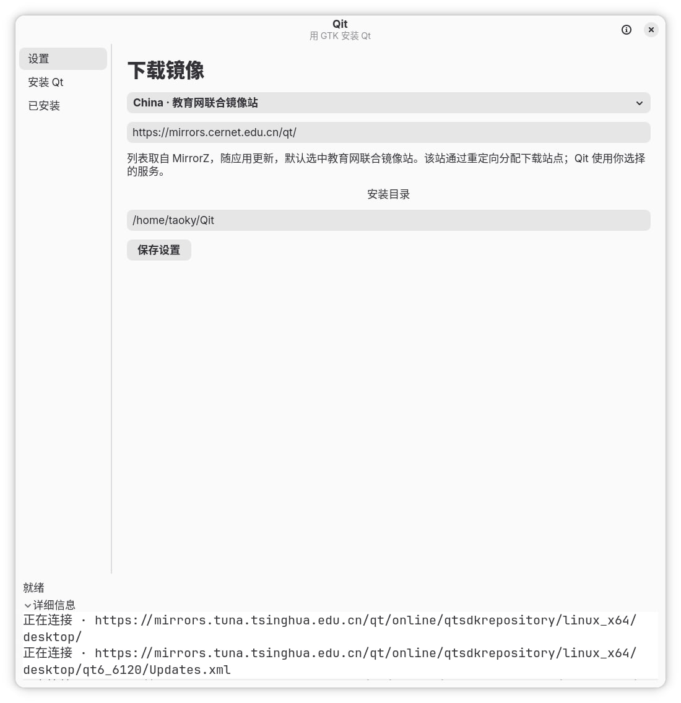
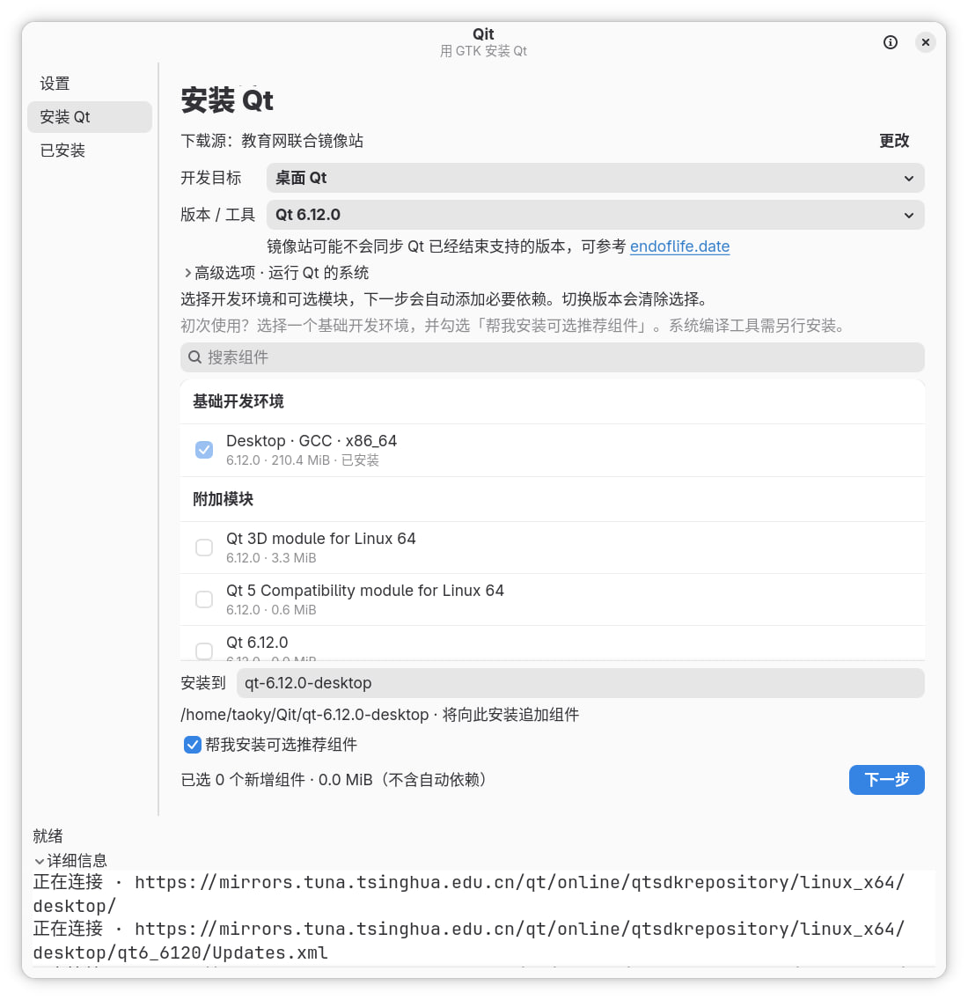
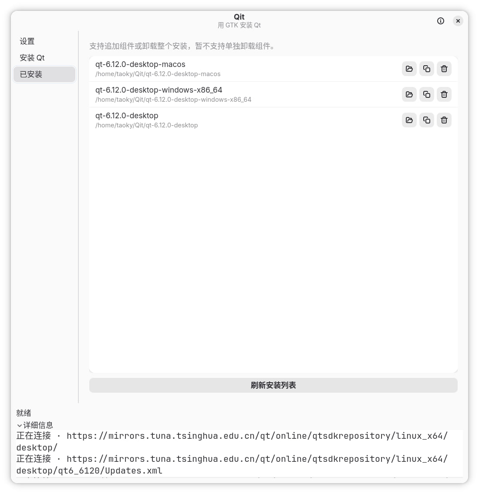

# Qit

使用 GTK 编写的 Qt 安装器，作为行为艺术，以抗议 Qt 上游对 [QTBUG-129057](https://qt-project.atlassian.net/browse/QTBUG-129057) 不配合、不作为的傲慢态度。该项目完全使用 LLM agent 生成（除了这个 README 是手写的以外）。

A Qt installer written with GTK, as a piece of performance art protesting Qt upstream’s arrogant refusal to cooperate or take action on [QTBUG-129057](https://qt-project.atlassian.net/browse/QTBUG-129057). This project was generated entirely by LLM agents (except for this README, which was written by hand).

即使不管上面讲的这些，Qit 也应该是可用的（而且对不少常见场景来说，比官方安装器更好用）。

Even setting all that aside, Qit should be usable—and for many common use cases, easier to use than the official installer.

## 背景 / Background

Qt 在线安装器基于 [Qt Installer Framework](https://doc.qt.io/qtinstallerframework/) 开发。其本身没有任何 UA 相关的设置，因此会回退到 [Qt Network 的默认值：`Mozilla/5.0`](https://github.com/qt/qtbase/blob/feb9556bde250306b5a1157aaccb76106844909e/src/network/access/qhttpnetworkconnection.cpp#L309)。

The Qt Online Installer is built on the [Qt Installer Framework](https://doc.qt.io/qtinstallerframework/). It does not configure a User-Agent (UA), so it falls back to [Qt Network’s default: `Mozilla/5.0`](https://github.com/qt/qtbase/blob/feb9556bde250306b5a1157aaccb76106844909e/src/network/access/qhttpnetworkconnection.cpp#L309).

但不幸的是，这个 UA 也被大量 bot 滥用，因此我曾尝试提交 [QTBUG-129057](https://qt-project.atlassian.net/browse/QTBUG-129057) 以希望 Qt 上游为自己的 installer 添加 UA。相关的修改是 trivial 的，但是上游拒绝对此合作，因此之前我们只能够给 Qt + `Mozilla/5.0` 的请求添加一个额外的例外，但是这让我们的配置变得复杂了很多，同时也是不可持续的。

Unfortunately, this UA is also widely abused by bots. I filed [QTBUG-129057](https://qt-project.atlassian.net/browse/QTBUG-129057) hoping that Qt upstream would give its installer a distinct UA. The change is trivial, but upstream refused to cooperate. We therefore had to make an extra exception for requests to the Qt mirror using `Mozilla/5.0`, which made our configuration much more complicated and is not sustainable.

所以，introducing Qit——（故意）不使用 Qt 框架的 Qt 安装器。它至少能够正确告知自己访问的 UA。该项目也允许其他镜像站放心地封禁 `Mozilla/5.0` 而不影响用户安装 Qt。

So, introducing Qit—a Qt installer that (deliberately) does not use the Qt framework. At least it identifies itself properly through its UA. This project also lets other mirrors block `Mozilla/5.0` without preventing users from installing Qt.

## 截图 / Screenshots

也支持命令行操作，参考 [LLM README](./LLM_README.md) 的说明。

Command-line usage is also supported. See the [LLM README](./LLM_README.md) for instructions.

## Q & A

### 默认选择的镜像是什么？ / Which mirror is selected by default?

<https://mirrors.cernet.edu.cn>。其会自己重定向到加入教育网联合镜像站计划的、距离你最近的教育网镜像站。

<https://mirrors.cernet.edu.cn>. It automatically redirects you to the nearest participating mirror on CERNET.

### 即使不考虑 UA 问题，Qit 相比 Qt Installer 有什么优势？ / Apart from the UA issue, what advantages does Qit have over Qt Installer?

- 不需要（也不支持）登录 Qt 账号。

  No Qt account login is required (or supported).

- 操作界面更加直观。

  A more intuitive interface.

- Qit 本身不收集使用统计、不上报持久设备标识。

  Qit itself does not collect usage statistics and persistent device ID.

- 使用镜像站点时，Qit 不会对 qt.io 进行任何访问。

  Qit does not access qt.io when selecting a mirror to use.

### 为什么使用 GTK？ / Why GTK?

- 很好玩，不是吗？

  It’s fun, isn’t it?

- 比 Electron 小。

  Smaller than Electron.

### 我不想使用 Qit，但是我使用的镜像封禁了 Qt Installer。 / I don’t want to use Qit, but my mirror blocks Qt Installer.

请参考 <https://github.com/tuna/issues/issues/1936#issuecomment-2737251530> 使用 `mitmproxy`。

Use `mitmproxy` as described in <https://github.com/tuna/issues/issues/1936#issuecomment-2737251530>.

### 可以停更吗？ / Can you stop updating this project?

待 QTBUG-129057 被修复之后，该项目就不会再更新。

Once QTBUG-129057 is fixed, this project will no longer receive updates.
